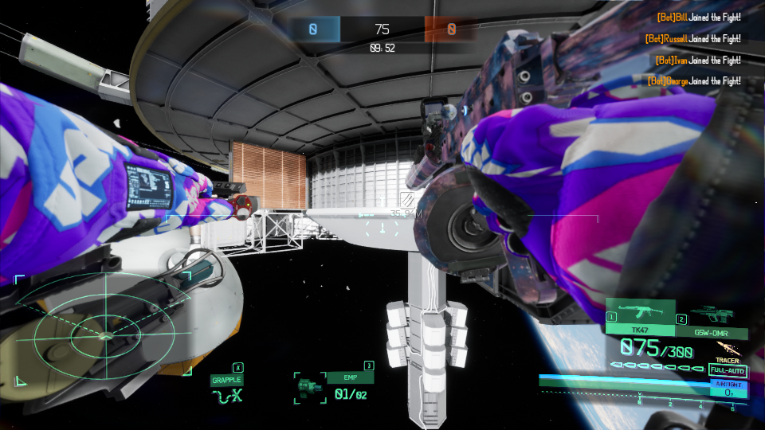
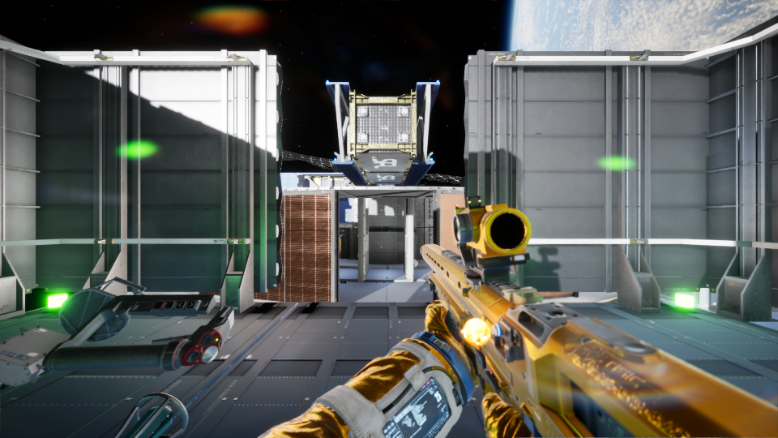

# BRT 19.20.36 / live40：MiniFarm 首命武器和钩索复用

本次复测使用 Steam Build 14530908、本机 PvE、普通难度 MiniFarm。两个游戏进程均使用正式玩家包时，奥兰（PEACE）第一条命看到了主枪，同一条命的两次钩索也都连上锚点。探针（PROBE）另用带观测的客户端验证。此前 live39 的首命截图来自 CircularX，未覆盖这次的地图。

## 第一条命只看得见手臂

玩家那局的服务端记录能确认 DMR 和 FOP 已随出生发放，看不到当时客户端为什么停止装备检查。旧代码有两条可独立复现的问题：开场时暂时失去对角色的控制，或枪只在短暂的过渡状态里出现，都可能让首命检查永久结束。

live40 等回合开始、第一人称镜头回到本人后才记下角色。过渡被打断会重新观察；同一把枪连续持稳 2 秒才结束检查。如果自己的主枪已在背包，双手持续空闲 800 毫秒，才执行一次游戏原有的装备动作。玩家正在切枪、开菜单或者已经阵亡时不会要求装备。[实现](../integrations/gameplay/community-first-loadout/FirstEquip.hpp) · [11 项首命回归测试](../integrations/gameplay/community-first-loadout/tests/first-equip.cpp)

**正式玩家包，奥兰。** 客户端与专服均从 ZIP 取同一份 DLL。在选角页部署后，没有按过切枪；首命画面右手可见枪身和弹鼓，HUD 的主枪为 TK47，专服同时读回配装里的主枪 AKM（游戏内显示为 TK47）。截图早于第一次出钩。

**观测客户端，探针。** 另一场也没有提前切枪。截图时死亡数为 0，回合已开始，第一人称相机对着本人，当前武器为 DMR。下图来自这条命，右手的枪身和瞄具均可见。

## 同一条命只能用一次钩索

旧版有时在专服开始监听后立即检查地图与网络驱动，检查当帧两者尚未关联，就跳过了关卡集合绑定。此时专服记录冷却已结束，客户端仍认为钩索在冷却。live40 等游戏建立两者的关联后，再为同一地图尚无驱动的关卡集合绑定当前驱动。没有缩短冷却时间，也没有直接清除玩家的冷却状态。[服务端补丁](../integrations/gameplay/community-world-driver/main.patch)

两场都使用游戏里映射到钩索的 X 输入。下表中的时间从对应生命的钩索观察开始计算；每一列的两次锁定都在同一个玩家、同一条命、同一个装备槽位，中间没有换人或更换模块。两个锁定点都由专服确认已连上锚点；PROBE 的观测客户端也收到了两次锁定事件。

| 专服观察 | 奥兰首命（正式 ZIP 双端） | 探针第二条命（观测客户端） |
| --- | --- | --- |
| 第一次连上锚点 | 11.133 秒 | 1.599 秒 |
| 收钩，进入冷却 | 12.900 秒 | 3.666 秒 |
| 原生冷却结束 | 20.902 秒 | 11.670 秒 |
| 第二次连上锚点 | 21.202 秒 | 13.104 秒 |

## 哪些步骤用的是玩家包

- 奥兰场的零售客户端和专服均用正式 DLL，无开发探针，向游戏自己的窗口发送选角、部署及 X 键输入。角色身份按服务端收到的部署确认记录。进房使用本机直连；未从 Steam 大厅重新操作一遍匹配。
- 探针场使用正式专服与带观测的零售客户端，选角走游戏控制器的确认入口，钩索走映射输入。两场测试均未直接调用装备、钩索锁定或冷却结束函数来制造结果。
- 从正式 ZIP 在无下载缓存的目录首次安装，补齐 945 个文件。另测重复安装、从上游 V0.8.4 和从公开 19.20.35 升级：旧 DLL 已备份，配装和房间设置保持不变。未知 DLL 保留原件，非支持的游戏 Build 提示退出。
- 本轮没有逐图、跨电脑联机或重测死亡 Esc 换人。后者的已有证据见 [live39 的 CircularX 换人与键鼠验收](BRT-LIVE39.md)。

玩家包 DLL 的 SHA-256：`0c18c5bfc9d923be2bf6162e68ddc70f014eb0a79e4eec7a37f91bef9b860941`。发布件不含开发探针；与实测专服原始发行构建相比，只把调试记录里的绝对 PDB 路径改成了文件名。
