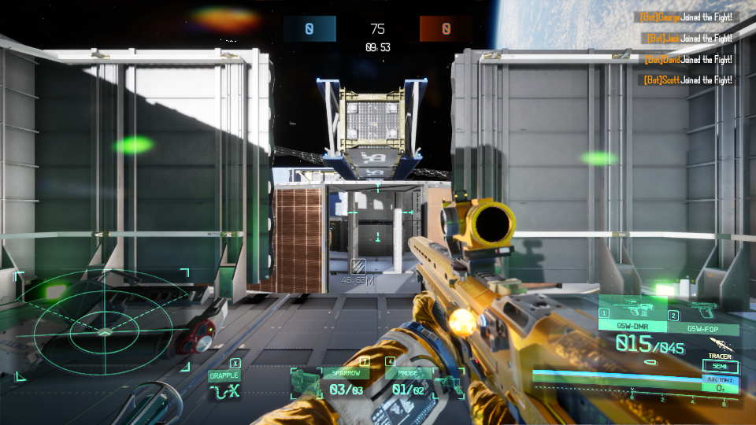

# BRT 19.20.37：用鼠标部署 PROBE 后，首命能正常看到 DMR

在 Steam《边境》Build 14530908 的普通 MiniFarm 本机人机局，客户端和专服都用了 19.20.37 玩家 ZIP 中的 live41 DLL。用鼠标点 PROBE 并部署，专服确认角色为 PROBE。没有按切枪；回合开始后，第一人称连续画面都能看到右手的金色 DMR 和瞄具。下图早于这一局第一次出钩。

## 为什么之前有时只看到手臂

19.20.36 用相同的鼠标选角流程时，专服已发放 DMR，HUD 也显示主枪和子弹，但手和枪只在画面上边缘露出一小截。[同图、同角色的旧版截图](images/live40-minifarm-probe-click.png)

隔离实测中，开场片段结束后，第一条命的镜头目标停在玩家控制器；复活后才指向角色本人。在第一条命仅把相机交回角色，同一把 DMR 就从异常位置回到正常的持枪视野，不需要换枪或重生。

live41 只修复这一种状态：本地 PvE 首命、回合已经开始、本人仍控制存活角色、当前确实是第一人称，且没有打开菜单或正在切换到另一台相机。相机目标稳定停在控制器上 800 毫秒后，才把镜头交回角色一次。开场动画和死亡镜头继续走游戏原来的流程。[实现](../integrations/gameplay/community-first-loadout/FirstEquip.hpp) · [15 项首命回归](../integrations/gameplay/community-first-loadout/tests/first-equip.cpp)

## 同一条命连续出钩

正式玩家包的同一场比赛中，第二条命用映射到钩索的 X 键实测。专服对同一玩家、同一条命、同一装备槽位记录：0.300 秒第一次锁定锚点，0.833 秒进入冷却，8.835 秒冷却结束，9.135 秒第二次锁定锚点。没有重生、换模块或强制清冷却。

## 安装与范围

成品 ZIP 在只含受支持游戏主程序的测试目录完成首次安装（补齐 945 个文件），并验证重复安装，以及从上游 V0.8.4、公开 19.20.35 和 19.20.36 升级。此轮复用了此前从公网下载的上游包，安装器重新校验 SHA-256。旧 DLL 备份可校验，原配装和房间配置不变，未知 DLL 和不支持的游戏 Build 不被覆盖。

游戏实测从本机进房，验证了实际选角与出生，没有重新在大厅操作匹配、逐图验证或跨电脑联机。死亡 Esc 换人的证据见 [CircularX 的既有验收](BRT-LIVE39.md)。正式 ZIP 的 SHA-256 为 `36e36aa5163a38e59eb5e5321ae0e8e8686f3b2ca6f340dd778af1d6fea164bc`。
